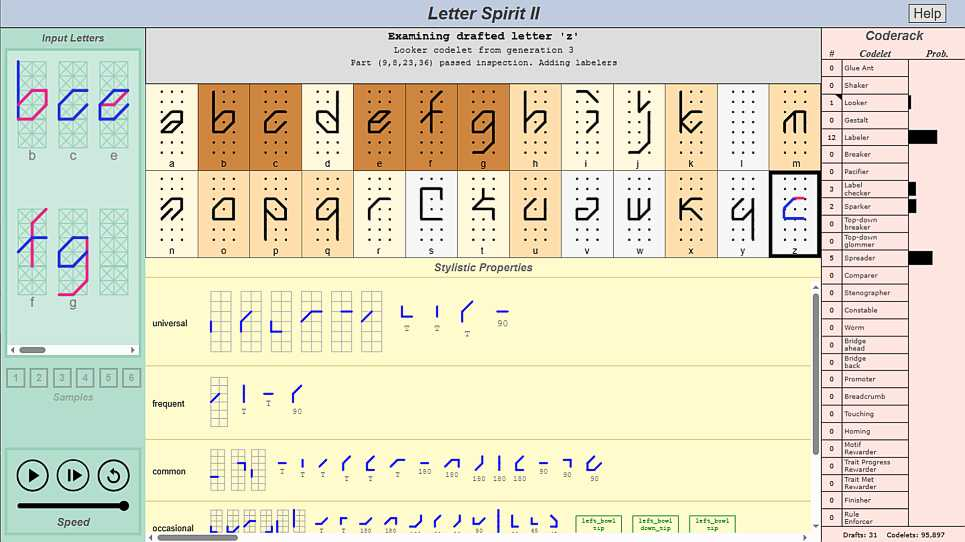
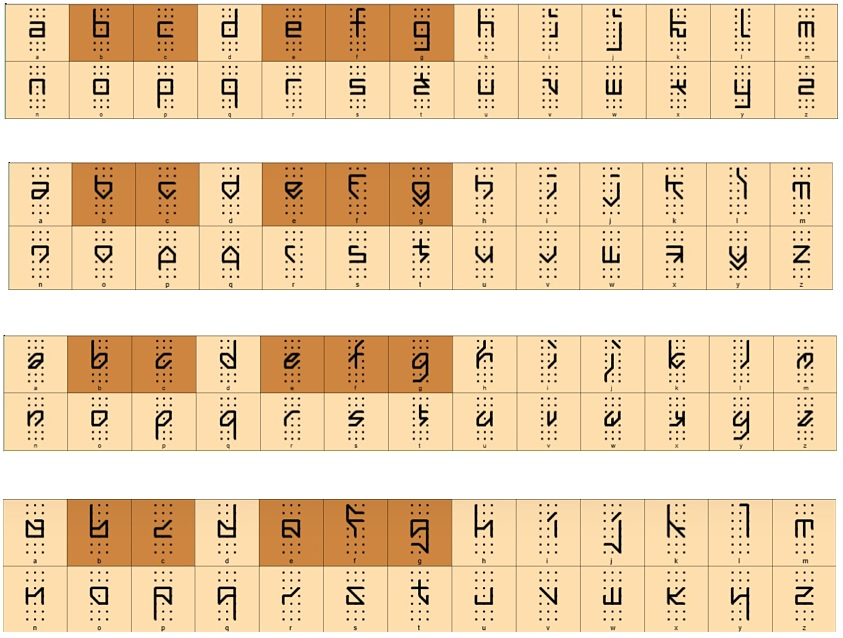

# letter-spirit-2-js

 

This is a JavaScript implementation of [Letter Spirit 2](https://en.wikipedia.org/wiki/Fluid_Concepts_and_Creative_Analogies#Chapter_10:_Letter_Spirit),
a computer model of human high-level perception and creativity, in the realm of letter-design. The model was invented by
 [John Rehling](https://scholar.google.com.br/scholar?q=john+rehling),
 [Gary McGraw](https://www.garymcgraw.com/), and
 [Douglas Hofstadter](https://en.wikipedia.org/wiki/Douglas_Hofstadter). 

[You can try it out here.](https://paul-g2.github.io/letter-spirit-2-js/index.html?seed=123)

Letter Spirit 2 is described in [John Rehling's Ph.D. thesis.](https://github.com/Alex-Linhares/FARGonautica/blob/master/Literature/Ph.D.%20Theses/Rehling-2001-Letter.Spirit.part.Two.pdf),
and in the book [<i>Fluid Concepts and Creative Analogies</i>](https://en.wikipedia.org/wiki/Fluid_Concepts_and_Creative_Analogies).

I got interested in Letter Spirit, and the Hofstadter group's other projects, after reading the <i>Fluid Concepts and Creative Analogies</i> book,
but I couldn't find demos that were easy to get up and running. Hence this repo, and my related repos for [Copycat](https://github.com/Paul-G2/copycat-js)
and [Letter Spirit Examiner](https://github.com/Paul-G2/letter-spirit-examiner-js).

My implementation is based entirely on [Rehling's original Scheme code](https://github.com/Alex-Linhares/FARGonautica/tree/master/Software/Letter-Spirit). 
The look of the UI is based on screenshots contained in [McGraw's thesis](https://www.garymcgraw.com/technology/writings/thesis/), and on [James Marshall's Metacat](http://science.slc.edu/jmarshall/metacat/).

A caveat: It's hard to be sure that I've ported the Scheme code correctly (not least because the algorithm is stochastic). 
My implementation generates sensible-looking results, and I wrote a lot of unit tests for its various parts, but of course it's possible I may have got some things wrong. If you spot any problems, please submit an issue!

  

Here are some sample outputs produced by the app (with random seed = 123):

